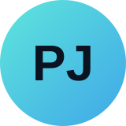

<div align="center">



# Pedro Jefte · Portfólio

**Desenvolvedor front-end em formação · em busca de estágio**

[](https://pedrojefte.github.io/)
[](https://www.linkedin.com/in/pedro-jefte-407651405/)
[](mailto:pedrojefte12@hotmail.com)


</div>

---

## ✦ Sobre o projeto

Meu site pessoal, feito com **HTML, CSS e JavaScript puro**, sem frameworks, e publicado no **GitHub Pages**.
Ele reúne quem eu sou, o que estou estudando e os projetos que já publiquei.

## ✦ O que tem

| | |
|---|---|
| 🧭 **Navegação por abas** | Sobre, Resumo e Portfólio sem recarregar a página |
| 🎬 **Card de projeto** | Ao clicar num projeto, abre um card com resumo, link do site e do repositório |
| 🗂️ **Filtro de projetos** | Filtra os projetos por categoria |
| 📱 **Responsivo** | Funciona no celular, no tablet e no computador |
| 🔗 **Prévia de link** | Imagem de prévia ao compartilhar no LinkedIn e no WhatsApp |
| 📄 **Currículo** | Botão para baixar o currículo em PDF |

## ✦ Estrutura

```
📁 pedrojefte.github.io
├── index.html                  # todo o conteúdo da página
├── curriculo-pedro-jefte.pdf   # currículo para download
└── 📁 assets
    ├── 📁 css/style.css        # cores e fontes ficam no topo, em :root
    ├── 📁 js/script.js         # abas, filtro e card dos projetos
    └── 📁 images/              # avatar, prints dos projetos, ícones e prévia
```

## ✦ Como adicionar um projeto

1. Coloque o print do projeto em `assets/images/`.
2. No `index.html`, na aba **Portfólio**, copie um bloco `<li class="project-item">` inteiro.
3. Troque o título, a categoria, a imagem e os textos dentro de `<template>`, que é o que aparece no card.

## ✦ Rodar localmente

Abra o `index.html` no navegador ou use a extensão **Live Server** do VS Code.

---

<div align="center">

Feito por **Pedro Jefte** · Recife, PE

<sub>Layout adaptado de um template de código aberto (licença MIT, veja <code>LICENSE-template</code>).</sub>

</div>
